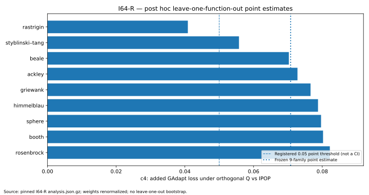
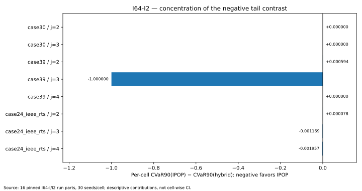

# I65 — Adversarial I64-R and I64-I2 influence review (2026-11-03)

**Scope:** new *post hoc* sensitivity calculations from frozen data in [`owlCoder/gadapt`](https://github.com/owlCoder/gadapt), pinned to baseline `6b56fbc53ffc4d275ecef5e911ea4663474c9a08`. **Not** a new iteration, hypothesis freeze, optimizer, COCO, OPF, PF, or power-flow evaluation. This is a source-level review for manuscript revision, not a supervisor signature.

## Executive scientific finding

Two archived, appropriately negative-aware I64 results are demonstrably **conditional on the frozen experimental composition**:

1. **I64-R / orthogonal transformation:** Registered c4 point = **0.070791780**, with original simultaneous CI **[0.059812, 0.081772]** and H64r3 reported *supported* on the fixed 21 cells and Q matrices. Removing the entire Rastrigin family post hoc and renormalizing original function weights gives c4 point **0.040866088**, *below the registered point threshold of 0.05*. This is a point sensitivity, **not** a new confidence interval or a change in H64r3's original set. H64r3 was one of **four** simultaneously tested contrasts, and its original registered decision remains **supported for 21 fixed cells**.
2. **I64-I2 / discrete ORPD:** Recalculation from 16 original compressed per-cell I/I2 run archives (3 selected algorithms × 8 cells × 30 paired seeds = 720 per-algorithm-cell outcomes) matches all four original I2 point contrasts within floating-point arithmetic. The `case39/j=3` cell has CVaR(IPOP)−CVaR(hybrid) = **−1.0** and contributes **−0.125** to the eight-cell mean **-0.125306761**, i.e. **99.755% of its net negative magnitude**. Removing that cell post hoc gives seven-cell point **-0.000350584**; no leave-one-cell confidence interval has been derived. H64h2 remains *opposite* on the original eight cells.

## 1. Source authenticity and calculation level

- I64-R: directly fetched and decompressed original `research/results/iteration64_r/analysis.json.gz`, Git blob `59025d6cc052baef76b14e5496962704bdb7604a`. Its 21 individual `per_pair` entries (all six config × variant ECDF means) were reweighted in the connector session, exactly recovering c1–c4. The portable review ledger retains derived per-pair c1/c2/c3 rounded to nine decimal places, so its local table is a **nine-decimal snapshot**, not a substitute for the pinned raw gzip. The provided independent Python verifier reads the full exact gzip when available in a local clone.
- I64-I / I64-I2: directly fetched and decompressed **eight** original `iteration64_i/run_part_*.json.gz` files and **eight** original `iteration64_i2/run2_part_*.json.gz` files. For each cell, 30 paired seed IDs and 12,000-call budgets were checked, and `best_feasible`, the reference `r`, and the task's configuration were used to independently compute loss and tail statistics. Source blob identities for all 16 files are enumerated in the JSON ledger. The original I2 analysis artifact is Git blob `2b38375126a43128dba37aaf7966b92eb6df8691`.
- Exact original 20,000-replicate **bootstrap draws and max-studentized simultaneous intervals were not independently rerun**. The underlying optimizers and the independent physical witness were not rerun; the archived `witness_checked` flags remain historical data.

## 2. I64-R: function-family leave-one-out

Frozen design: 21 function–dimension pairs, 100 seeds/configuration and 12,000 objective calls, one fixed orthogonal Q (potentially a reflection) per paired task. Function families receive 1/9 total weight each. For functions with dimensions 2, 7 and 20, each pair receives 1/27; the three two-dimensional-only functions receive 1/9 per pair. The registered contrasts are:

- c1 = A_G(rotm) − A_G(rot), c2 = A_G(shift) − A_G(rotm)
- c3 = A_IPOP(shift) − A_IPOP(rotm), **c4 = c2 − c3**.

Reconstructed frozen point estimates: c1 = 0.003094198, c2 = 0.080886368, c3 = 0.010094588, c4 = 0.070791780. The original 95% simultaneous interval for c4 is **[0.0598118697, 0.0817716899]**, conditional on those fixed tasks, and should not be attached to any LOO estimate.

| Removed objective family | Number of cells removed | Renormalized c2 | Renormalized c4 | c4 point above 0.05? |
|---|---:|---:|---:|---|
| rastrigin | 3 | 0.052461 | 0.040866 | no |
| styblinski_tang | 3 | 0.058030 | 0.055753 | yes |
| beale | 1 | 0.082337 | 0.070276 | yes |
| ackley | 3 | 0.084427 | 0.072788 | yes |
| griewank | 3 | 0.084920 | 0.076589 | yes |
| himmelblau | 1 | 0.090531 | 0.078766 | yes |
| sphere | 3 | 0.090896 | 0.079650 | yes |
| booth | 1 | 0.091589 | 0.080232 | yes |
| rosenbrock | 3 | 0.092785 | 0.082207 | yes |


The full Rastrigin family accounts for ~**48.69%** of the signed net positive c4 point (its weighted contribution is ~0.03446637 versus total ~0.07079178). Fourteen of 21 pairwise c4 effects are positive and seven are negative. Dropping only the dimension-7 subgroup leaves c4 point ~0.051943; dropping all dimension-2 pairs leaves ~0.115489. These are exploratory descriptive sensitivity calculations, not pre-specified hypothesis tests.

**Interpretation:** The original supported finding is valid for the preregistered 21-cell estimand. It is **not demonstrated** to be uniformly robust across objective-function families. Bootstrap uncertainty restricted to seeds does not capture resampling of objective families, 21 Q matrices, or shifts.



## 3. I64-I2: direct per-cell CVaR reconstruction from original runs

The frozen rule in `research/i64/i2_study.py` maps a run with **no feasible result** to `(L=1, P=0)`. Otherwise it maps the best feasible cost f to `G=max((f−r)/r,0)` and `L=G/(1+G)`, with `P=1`. For 30 seeds, CVaR₀,₉ is the mean of the **three largest** losses in a cell. Each of eight cells has weight 1/8 in the original aggregate. The I64-I and I64-I2 records share the same case, task seed and reference value r; no resampling is needed for the point estimates.

| Cell | GAdapt feasible | Hybrid feasible | IPOP feasible | CVaR(M) | CVaR(H) | CVaR(IPOP) | Δ: IPOP − H |
|---|---:|---:|---:|---:|---:|---:|---:|
| case30 / j=2 | 30/30 | 30/30 | 30/30 | 0.006527 | 0.006527 | 0.006527 | +0.000000 |
| case30 / j=3 | 0/30 | 0/30 | 0/30 | 1.000000 | 1.000000 | 1.000000 | +0.000000 |
| case39 / j=2 | 30/30 | 30/30 | 30/30 | 0.003877 | 0.000948 | 0.001542 | +0.000594 |
| case39 / j=3 | 29/30 | 27/30 | 30/30 | 0.333333 | 1.000000 | 0.000000 | -1.000000 |
| case39 / j=4 | 0/30 | 1/30 | 5/30 | 1.000000 | 1.000000 | 1.000000 | +0.000000 |
| case24_ieee_rts / j=2 | 30/30 | 30/30 | 30/30 | 0.006449 | 0.000013 | 0.000091 | +0.000078 |
| case24_ieee_rts / j=3 | 30/30 | 30/30 | 30/30 | 0.009375 | 0.001798 | 0.000629 | -0.001169 |
| case24_ieee_rts / j=4 | 30/30 | 30/30 | 30/30 | 0.018505 | 0.007914 | 0.005957 | -0.001957 |


The independent archive-level point reconstruction gives:

| Frozen contrast | Recalculated point |
|---|---:|
| CVaR(M) − CVaR(H) | -0.079891708 |
| P(H) − P(M) | -0.004166667 |
| CVaR(IPOP) − CVaR(H) | -0.125306761 |
| P(H) − P(IPOP) | -0.029166667 |

All four reproduce the original frozen analysis's point values (absolute differences below 1×10⁻¹²). Original H64h1 remains *undecided*, H64h2 *opposite*; the original IPOP-vs-hybrid tail interval was **[−0.250223907, −0.000389615]**, in the opposite direction to a hybrid-tail advantage.

### Three consequential facts for interpretation

1. **Concentration:** in `case39/j=3`, IPOP is feasible for 30/30 seeds, GAdapt-M 29/30 and the hybrid 27/30. Exactly three infeasible hybrid outcomes occupy all three positions of the worst decile, making CVaR(H) = 1. IPOP has CVaR(IPOP)=0. This cell contributes −1/8 to the total eight-cell contrast of −0.1253067611, **99.755% of its net signed magnitude**. The other seven cells sum to −0.0024540889 in unweighted raw differences, a seven-cell renormalized mean of −0.0003505841.
2. **Explicit reproducibility targets:** the original I64-I2 archive has no feasible witness for hybrid seeds **68003015**, **68003018**, **68003028** in this cell; original GAdapt-M lacks a feasible witness at seed **68003023**; IPOP has none missing. Those technical runs are marked `ok=true`, budget 12,000 and `witness_checked=false` for the no-witness cases. Their original outputs were not modified or rerun.
3. **Saturation:** `case30/j=3` has 0/30 feasible runs for all three configurations and all three CVaR values equal 1. In `case39/j=4`, feasible counts differ (M: 0/30, H: 1/30, IPOP: 5/30), but every configuration's CVaR also equals 1 because the worst three outcomes are all infeasible. Reporting CVaR together with **P(feasible)** is essential: a saturated CVaR cannot resolve these feasibility differences.



## 4. Inference boundaries — do not overstate

- **No reversal of registered tests.** A leave-one-out point estimate is a different, post hoc estimand with no newly computed simultaneous CI. Its crossing of a numerical threshold does not create a new supported/opposite verdict.
- **No claimed mechanism** beyond the observed response under fixed orthogonal transformations. No generalization to other Haar draws, all objective functions, industrial grids or different ORPD constraints.
- **No optimization or physical PF rerun.** The independent calculations recompute reported quantities from existing original run outcomes and direct compressed per-pair archives; they do not independently validate AC physics or stochastic search traces.
- **Human gates remain open.** Novel optimizer contribution NOT ESTABLISHED; original status `NO-FREEZE / COCO NOT_RUN`; supervisor M6/C1 and independent statistical acceptance unsigned. Both manuscripts remain drafts, not submitted work.

## 5. Reproducibility commands

From a full, unmodified checkout of `owlCoder/gadapt` at the pinned commit:

```bash
python i64_r_family_sensitivity.py --repo-root /path/to/gadapt --output i64_r_sensitivity.json
python i64_i2_cell_influence.py --repo-root /path/to/gadapt --output i64_i2_influence.json
python i64_i2_bootstrap_replay.py --repo-root /path/to/gadapt --output i64_i2_bootstrap.json  # optional, numpy, NOT RUN in this session
python -m pytest -q test_i64_r_family_sensitivity.py test_i64_i2_cell_influence.py
```

All archive accesses are read only. The full-clone commands were not executed here because GitHub network DNS is unavailable to the local runtime; original data were extracted through the connected GitHub app in this conversation. The Git SHA-1 blobs and numerical details are preserved in `I65_I64_R_I2_INFLUENCE_LEDGER_2026-11-03.json`.
