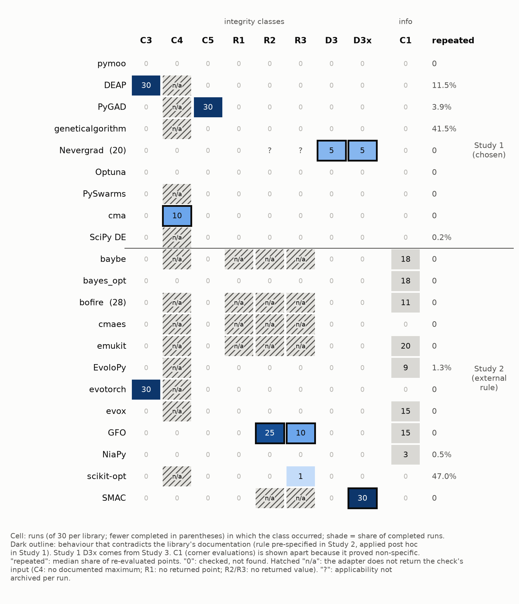

# Does the optimizer do what it says? A black-box audit of evaluation integrity in 21 Python optimization libraries

*Manuscript draft, revised 23 October 2026 after an independent review. The four main studies were preregistered
before code was written and each was run once; diagnostic and patch experiments were done afterwards and are labelled
post hoc. Code, inputs, raw outputs and protocols are in `owlCoder/gadapt`, directory `research/` (Section 10).*

## Abstract

Comparisons of black-box optimizers assume that each optimizer evaluates the cost function as its documentation says
and reports what it actually found. In engineering applications such as power-flow-based dispatch, every hidden,
repeated or out-of-budget evaluation costs real compute, and every inconsistent report can change a comparison. We
present a library-independent black-box audit that records every call to the cost function and checks call-level
integrity (out-of-box, over-budget and post-return evaluations, repeated points), the consistency of the reported
result with the recorded calls, and reproducibility under a fixed seed within one process and between fresh
processes. The audit is validated on planted faults. Across 21 Python libraries in two preregistered studies (nine
popular libraries chosen by us and twelve selected by a deterministic external rule), with one prespecified
configuration per library, integrity findings other than corner evaluations occurred in 8 of 21 tested
configurations and behaviour contradicting the library's own documentation in 4 of 21. On a real AC
economic-dispatch cost function (pypower, MATPOWER cases), the library-level detection status agreed with the
test-function studies for 19 of 21 libraries, and 7 of the 8 libraries with a finding showed one again. The real cost
function also exposed behaviour the test functions missed: SciPy `differential_evolution` discards an improving
polished point when L-BFGS-B reports `success=False`. We diagnosed and disclosed five issues with minimal
reproducers, three of which we did not find reported in a documented search: seed dependence of SMAC 2.4.1 on
`PYTHONHASHSEED`, a sign flip in the reported cost of Gradient-Free-Optimizers 1.13.0, and the SciPy polishing
behaviour. A preregistered "corner evaluation" measure proved non-specific on test functions; we report this negative
result. We recommend running such an audit, including a cross-process reproducibility check, before comparing
optimizers on an expensive cost function.

## 1. Introduction

Benchmarking practice in evolutionary computation counts function evaluations carefully: COCO (Hansen et al. 2021)
and IOHexperimenter (de Nobel et al. 2024) wrap the objective and record every call. Practitioners who compare
optimizers on their own expensive models rarely use such platforms. They call libraries directly through the
library's own budget, seed and result interfaces, and trust that:
1. the budget parameter bounds the number of evaluations;
2. every evaluation happens inside the declared box and during the search;
3. the returned solution and cost are the best evaluated pair;
4. a fixed seed reproduces the run.

When any of these fails silently, the comparison is wrong in a way that no statistical test reveals.

The work started from a concrete case. In our own library, GAdapt, input validation evaluated the cost function at
the all-lower and all-upper corners of the box. On a binary route-choice problem, the all-lower corner is the trivial
first-path solution. Most likely, these two hidden evaluations made a validation probe look like a search result in
an earlier experiment (Section 7.1). The original raw data of that experiment are no longer available, so this
remains the most plausible reading, not a verified fact. This raised a general question: how often do optimization libraries evaluate, count,
reproduce or report differently from what their users assume?

**Contributions:**
1. A black-box, library-independent audit with explicit call classes and result-consistency checks. Its
   cross-process reproducibility check (D3x) adapts known hash-order randomization to the seed contract of
   optimization libraries and exposes seed failures that within-process checks miss.
2. Validation of the audit on planted faults, including faults that are only visible across processes.
3. Two preregistered prevalence studies on 21 Python libraries, one of them drawn by an external sampling rule,
   and a third study that adds cross-process reproducibility to the first sample.
4. A preregistered transfer study on a real infrastructure cost function (AC economic dispatch) for all 21 libraries.
5. Five diagnosed defects with minimal reproducers, causal patch tests where applicable, and disclosure to the
   maintainers.
6. A negative methodological result: a natural "probe" measure is not specific on test functions, which changes
   the prevalence estimate.
7. A practitioner command-line tool with a six-step checklist.

## 2. Related work

- **Evaluation accounting and benchmarking platforms.** COCO (Hansen et al. 2021) and IOHexperimenter (de Nobel et
  al. 2024) count evaluations and log performance. IOHexperimenter can also wrap an arbitrary user callable
  (`ioh.wrap_problem`), so wrapping and counting a user objective is established. These platforms log what the
  optimizer evaluates; they do not check the reported result against the recorded calls, compare behaviour with the
  library's documented contract, or test reproducibility across processes.
- **Invariance and structural bias.** Kudela (2022) showed that many metaheuristics exploit the centre of the search
  space. BIAS (Vermetten et al. 2022) detects structural bias from final positions. Invariance testing is an
  established principle (Hansen et al. 2011). We use invariance only as a secondary property and claim no novelty
  for it.
- **Comparing frameworks.** Ravber et al. (2025) compared six algorithms across 13 frameworks, found large
  performance differences between implementations of the "same" algorithm, and analysed source code, including
  redundant fitness evaluations, missing evaluation-based stopping and implementation defects. Our audit is
  complementary: it is black-box, classifies every call, and checks reported results and the documented seed contract.
- **Metamorphic testing** has been applied to genetic algorithms (Rounds and Kanewala 2018) and to industrial
  optimisation software (Duque-Torres et al. 2025a, 2025b). It checks relations between runs and is closest in
  spirit to our seed and documentation checks. Its targets are algorithm or application properties, not the
  evaluation contract between a library and its user.

- **Nondeterminism from iteration order.** Hash-based iteration order is a known source of flaky tests. NonDex
  (Gyori et al. 2016) randomizes the iteration order of Java collections to expose code that relies on an
  unspecified order, and Gruber et al. (2021) studied flaky tests in Python. Our D3x applies the same idea, varying
  `PYTHONHASHSEED` between two fresh processes, to the documented seed contract of optimization libraries. We claim
  no novelty for the technique.

**Our claim is narrow.** No component (wrapping and counting, invariance, seeding, hash-order randomization) is new
in isolation. The contribution is the integration into one validated, library-independent black-box audit that
classifies every call, checks reported results against recorded calls and documented relations, including
cross-process reproducibility, together with the empirical diagnoses it produced. "Previously unreported" in this
paper means not found in our documented search of each project's issue tracker and changelog (23 October 2026).

## 3. The audit

A recorder wraps the user's cost function and stores, for every call, the point x, the value f and a phase: search,
or post, meaning after the optimizer's main call returned. Each library is run through a small adapter that uses only
its documented interfaces for budget, seed, bounds and result.

| Class | Definition | Integrity? |
|---|---|---|
| C1 | x equals the all-lower or all-upper corner of the box | preregistered as integrity; see Section 6.3 |
| C2 | x bit-identical to an earlier evaluated point | waste (reported as a share) |
| C3 | some coordinate of x outside [lower, upper] | yes |
| C4 | more calls than a documented maximum (only where one is documented) | yes |
| C5 | calls after the optimizer's main call returned | yes |
| R1 | reported x\* was never evaluated (every coordinate within 1e-12) | yes |
| R2 | reported f\* differs from the recorded f(x\*): \|f\* − f(x\*)\| > 1e-9 · max(1, \|f(x\*)\|) | yes |
| R3 | reported f\* worse than the best search-phase value b: f\* − b > 1e-9 · max(1, \|b\|) | yes |
| D2 | reported evaluation count differs from the recorded count | yes |
| D3 | same seed, different call sequence on a rerun in the same process | yes |
| D3x | same seed, different call sequence in two fresh processes (see the note on hash seeds below) | yes |

The call sequence is compared through a SHA-256 hash over (x, f, phase) for all calls. Exact predicates, phase
boundaries and applicability rules are in Appendix A.

**Note on hash seeds (correction).** The protocols intended D3x to compare two processes with `PYTHONHASHSEED` 1 and 2.
The Study 2–4 launchers started the library interpreter with `python -I`, which implies `-E` and ignores
`PYTHONHASHSEED`. Each process therefore had Python's default, independent per-process hash randomization. D3x as
run compares two fresh processes with independent random string hashing; it detects the same class of
nondeterminism, but the controlled same-seed/different-seed comparison was not performed by the audit. The SMAC
attribution to `PYTHONHASHSEED` rests on a separate reproducer run without `-I` (Section 6.2), which we re-ran:
`PYTHONHASHSEED`=1 twice gives the identical incumbent, 2 and 3 give different ones. A corrected rerun of D3x with
an effective hash seed and a recorded sentinel hash, together with archived call traces, is preregistered as Study 5. R1–R3 are not applicable
when a library returns no result, as in ask-and-tell interfaces. For libraries that work in float32, the recorder
stores the value the library actually receives, so that rounding is not counted as R2.

**Test problems:**
- shifted sphere, with the optimum at 0.37 of the range;
- Rastrigin;
- the floor plateau Σ⌊x_i⌋;

in N ∈ {2, 10}, on the box [−5, 5]^N, with seeds 6000–6004. This gives 30 cells per library.

## 4. Validation of the audit

Before each study, a reference random search was run with exactly one planted fault per mutant. Faults covered:
- a corner probe;
- a re-evaluated duplicate;
- one call over the budget;
- reporting an unevaluated point;
- reporting a wrong value;
- seeding from `hash()`, visible only across processes;
- seeding from the clock.

The audit had to flag exactly the planted class and nothing on the clean reference. GAdapt with its default input
validation had to produce C1, and without it had to produce none. All checks passed: 8/8 in Study 1 and 11/11 in
Study 2. The practitioner tool repeats these checks in its test suite.

## 5. Studies

Both protocols, including the decision thresholds and the documentation-classification rule of Study 2, were
committed before any code was written.

**Study 1 (I49).** Nine popular libraries:
- pymoo GA;
- DEAP `eaSimple`;
- PyGAD;
- geneticalgorithm;
- Nevergrad `NGOpt`;
- Optuna TPE;
- PySwarms;
- cma `fmin2`;
- SciPy `differential_evolution`.

Settings: one prespecified configuration per library (mostly defaults; operator or population choices where the
API requires them, frozen in the protocol), about 1000 evaluations, set through the documented parameter. GAdapt served as a
positive control.

**Study 2 (I50).** A new sample drawn by an external rule from a frozen snapshot:
- **Source A:** GitHub repositories in Python with at least 300 stars and one of 12 optimization topics.
- **Source B:** the Python frameworks in Ravber et al. (2025).
- **Eligibility:** general-purpose library, not archived, installable on Python 3.14 with NumPy 2.x, documented
  box-constrained single-objective API, and a smoke test with a constant cost function.

Of 62 candidates, 12 were eligible: baybe, bayes_opt, bofire, cmaes, emukit, EvoloPy, evotorch, evox,
Gradient-Free-Optimizers (GFO), NiaPy, scikit-opt and SMAC. The budget was 200 evaluations. Before the run, we froze
the configurations and the documentation quotes for budget, seed, result and bounds.

**Study 3 (I51).** D3x on the Study 1 sample, with the unchanged Study 1 adapters.

**Study 4 (I52).** All 21 libraries, with unchanged adapters and budgets, on a real infrastructure cost function: AC
economic dispatch with fixed voltages.
- **Cost function:** pypower `runpf` on MATPOWER case14, case39 and case118 (4, 9 and 53 variables). The cost is
  generation cost plus penalties for voltage, slack, reactive and branch-loading violations; 2–16 ms per evaluation.
- **Seeds:** 5 per case.
- **Preregistered hypothesis:** the library-level status (≥ 1 integrity finding, C1 excluded) agrees with the
  synthetic studies for ≥ 17/21 libraries.
- **Deviation:** the first execution failed at import in every cell, before any evaluation (a missing dependency and
  a pypower version incompatible with NumPy 2.5). It was archived, the environment was fixed, and the study was run
  once.

## 6. Results

### 6.1 Prevalence

| Outcome | Study 1 | Study 2 | Pooled |
|---|---|---|---|
| ≥ 1 finding, all classes (preregistered) | 4/9 (14–79%) | 11/12 (62–100%) | 15/21 (48–89%) |
| ≥ 1 finding excluding C1 (post hoc, Section 6.3) | 4/9 | 4/12 (10–65%) | 8/21 (18–62%) |
| ≥ 1 finding excluding C1 and design-caused C3 (post hoc) | 3/9 | 3/12 | 6/21 (11–52%) |
| Behaviour contradicting the library's documentation | 2/9 | 2/12 (2–48%) | 4/21 (5–42%) |

Clopper–Pearson 95% intervals are in parentheses. They describe binomial uncertainty conditional on treating the
tested configurations as exchangeable draws; Study 1 is a purposive sample and Study 2 a deterministic rule, so the
intervals are model-dependent summaries, not estimates for a defined population of libraries. Each library was tested
in one configuration, which does not characterize every algorithm it contains.

**Cross-process reproducibility on all 21 libraries.** Study 3 found D3x in 1 of the 9 Study 1 libraries: Nevergrad,
in the same cells as D3. Over both samples, a fixed seed fails to reproduce the run for 2 of 21 libraries, Nevergrad
and SMAC. The SMAC case is visible only across processes.

**Waste.** The median share of repeated evaluations was 47% for scikit-opt DE, 41.5% for geneticalgorithm and 11.5%
for DEAP. With an expensive cost function, that is close to half of the budget.

**Figure 1.** Runs with each finding class, per library, in the test-function studies (1–3). Dark outlines mark
behaviour that contradicts the library's documentation (a curated input of `make_figure.py`, frozen with the Study 2
quotes). C1 is shown apart (Section 6.3). D2 is not shown: it was never flagged. The right column gives the median
share of repeated evaluations. Generated by `make_figure.py` from the raw outputs.

### 6.2 Findings and diagnoses

| Library | Finding | Cause | Status |
|---|---|---|---|
| DEAP | evaluations outside the box (30/30 runs) | bounds are the user's responsibility | design; previously noted (Ravber et al. 2025) |
| PyGAD | 21 evaluations after return | `best_solution()` without `pop_fitness` re-evaluates the population | documented |
| cma | up to 1011 evaluations for `maxfevals` = 1000 | the maximum is checked per iteration | known (pycma #195) |
| Nevergrad | `NGOpt` not reproducible under a fixed seed (D3, and D3x from the first evaluation) | `cma.fmin` called without a seed (pycma default `seed='time'`); the metamodel's inner optimizer is created without a seeded parametrization | known issue (#1572, open since 2023); **root cause and a 12-line patch are ours** |
| SMAC 2.4.1 | D3x in 30/30 runs, no D3 | `LocalSearch._get_initial_points` returns `list(set(...))` of `Configuration`, whose hash is a string hash | not found in documented search; reported (#1380) |
| GFO 1.13.0 | R2 in 25/30 runs, R3 in 10/30 | with `optimum="minimum"`, the internal negation is not undone in `best_score` or `search_data` | not found in documented search; reported (#106) |
| scikit-opt DE | R3 in 1/30 synthetic and 2/15 dispatch runs; 10/200 seeds on a 10-D sphere; 301 calls for a nominal 200 | after selection, `self.Y` holds only trial values, so a retained parent better than all trials is never seen as best; parents are re-evaluated every generation | a title-only report existed (#187); **cause diagnosed, fix tested (10/200 → 0/200)**, reported (#248) |
| SciPy DE 1.18.1 | R3 in 5/15 dispatch runs, none on test functions; returned value up to 89% worse than an evaluated point | an improving polish is accepted only if L-BFGS-B reports `success=True` | behaviour not described in the documentation (a documentation gap, not a contract violation); not found in documented search; reported (#26479); reproduced on the nightly build |
| evotorch SNES | evaluations outside the box | SNES does not support hard bounds; the README uses `initial_bounds` | design |
| bayes_opt | on the plateau, 7 of 200 requested evaluations | a repeated suggestion returns a cached value but consumes an iteration | documented in `TargetSpace.probe` |

**Causal checks:**
- **Nevergrad:** with our patch, the full call sequence was identical within and across processes in 16/16 cells,
  against 0/6 unpatched. The issue's original reproducer became deterministic.
- **SMAC:** order-preserving de-duplication made the sequence independent of `PYTHONHASHSEED`. With default hash
  randomization, three runs with `seed=0` gave three different incumbents.
- **GFO:** reproduced on the development branch; the proposed fix was not tested.

### 6.3 A negative result: corner evaluations are not specific

C1 was designed to catch input-validation probes such as GAdapt's. In Study 2 it fired for nine libraries, almost
always for legitimate reasons:
- clipping to the bounds in particle swarms;
- acquisition optima at the boundary in Bayesian optimization;
- deliberate vertex initialization (GFO `initialize={"vertices": 4}`);
- on the plateau, the lower corner is the region of the global optimum.

No Study 1 library had a C1-only finding, so the Study 1 estimate is unaffected.

The preregistered Study 2 verdict ("common", 11/12) is therefore driven by a non-specific class. Excluding C1, which
is a post hoc analysis, gives 4/12. Under the same thresholds this would be inconclusive: the lower bound of 9.9% is
just below the 10% threshold.

We report both and treat the C1-free estimate as the defensible one. The practitioner tool reports corner
evaluations as information, not as a problem.

### 6.4 Transfer to a real infrastructure cost function

**Hypothesis supported, in the preregistered sense.** The library-level detection status (≥ 1 finding, C1 excluded)
agreed for 19 of 21 libraries (95% CI 70–99%). Agreement includes absence: the confusion matrix (test functions ×
dispatch) is 7 positive/positive, 12 negative/negative, 1 positive/negative (Nevergrad) and 1 negative/positive
(SciPy DE). Of the 8 libraries with a finding on test functions, 7 showed one again on dispatch. Completion was
295 of 315 dispatch cells (Nevergrad 10, bayes_opt 5 and bofire 5 cells failed), which limits the evidence for
negative status of those libraries; dispatch also offered 15 cells per library against 30 synthetic.
- **Findings that transferred:** 7 of the 10 (library, class) findings from the test functions reappeared: DEAP C3,
  PyGAD C5, cma C4, evotorch C3, GFO R2, scikit-opt R3 and SMAC D3x.
- **Findings that did not transfer:**
  - Nevergrad's D3 had appeared only on the 10-D plateau, and on dispatch 10 of its 15 cells crashed with a NumPy 2.5
    error.
  - GFO's R3 on the test functions is plausibly a side effect of the sign flip on negative plateau values.
- **One new finding, only on the real cost function:** SciPy DE, in 5 of 15 runs. On case118, L-BFGS-B polishing
  used 15,444 evaluations, stopped at its `maxfun` limit and reached 143,102; the returned value was 271,061. The same
  behaviour appears on a 10-D quadratic with a penalty wall, where the returned value was 22.97 against an evaluated
  1.10, and on the SciPy nightly build.
- **Total evaluations for SciPy DE:** 1,270–16,239 for a nominal DE budget of 795–960. The documented formula excludes
  polishing.
- **C1 on dispatch:** it fired for the GAdapt control in 15/15 runs and less often otherwise (GFO 4, SciPy DE 4,
  evox 1, out of 15). Without a ground-truth classification of these hits, this does not establish specificity on
  dispatch; it only shows that the plateau inflated C1 on test functions.
- **Waste on dispatch (median share of repeated evaluations; waste only for deterministic, cacheable objectives):** scikit-opt DE 36%, geneticalgorithm 9.1% and DEAP
  8.4%. The synthetic plateau overstated geneticalgorithm's waste, which was 41.5% there.

## 7. Discussion

### 7.1 Why this matters for comparisons

Each defect class changes a typical comparison:
- **GAdapt case.** The hidden corner evaluations most plausibly turned a validation probe into an apparent search
  result; the original raw data are lost, so this remains an interpretation (Section 1).
- **GFO.** Comparing GFO's `best_score` across minimizers would rank it as finding negative costs.
- **SMAC.** Seeded results cannot be reproduced by a reader who reruns the script, because Python randomizes string
  hashing per process.
- **scikit-opt DE and geneticalgorithm.** Spending nearly half the budget on repeated points halves the effective
  budget in an equal-budget comparison.
- **cma.** Over-budget evaluations make equal-budget comparisons slightly unequal.

### 7.2 Why cross-process checks

Within-process reruns did not detect the SMAC issue. Python's per-process hash randomization makes any iteration
over a set of hashable objects whose hash depends on strings a hidden source of randomness. The audit catches this by
running two fresh subprocesses with different string hashing. The launcher must not use `python -I` (or `-E`), which
silently ignores `PYTHONHASHSEED`; the corrected tool uses `-s` with `PYTHONSAFEPATH=1` and records a sentinel hash
per process to prove which hash seed was in effect.

## 8. Threats to validity

- **Sampling.** GitHub topics and star thresholds are incomplete, so we added an external source. Eligibility
  excluded several libraries for installation or packaging reasons, on Python 3.14 with NumPy 2.x. A strict
  smoke-test rule excluded gaft because it divides by zero on a constant cost function.
- **Sample selection.** The Study 1 sample was chosen by us. Only the Study 2 sample follows an external rule. The two
  studies also differ in budget (1000 against 200).
- **What counts as a problem.** C3 in DEAP and evotorch reflects missing bounds handling, which the libraries leave to
  the user or do not support. PyGAD's post-return evaluations are documented. These count under the preregistered
  definition. Excluding C1 and the two design cases of C3 leaves 6/21 libraries (11–52%). The strictest measure,
  behaviour that contradicts the documentation, gives 4/21.
- **Test functions versus real costs.** Test functions both over- and under-state problems: they made C1 look
  non-specific and overstated waste, and they missed the SciPy defect. Study 4 covers one infrastructure problem
  class (AC dispatch) and is no guarantee for others.
- **Configuration.** We used one prespecified configuration per library through the documented interfaces and small budgets (200 or
  1000). Other usage may behave differently.
- **Applicability.** R1–R3 do not apply to libraries without a reported result. C4 applies only where a maximum is
  documented.
- **Post hoc analyses.** The C1 sensitivity analysis and the causal diagnoses were done after the runs and are
  labelled as such. The preregistered outcomes are reported unchanged.
- **D3x launcher.** In Studies 2–4 the intended hash seeds were not applied (`python -I`, Section 3). Positive D3x
  findings still show cross-process nondeterminism; Study 5 repeats D3x with effective, recorded hash seeds.
- **Archived evidence.** Studies 1–4 archived per-run counts, flags and hashes, not full call traces, so classes
  cannot be recomputed independently from the archive. Study 5 archives compressed call traces and returned results,
  with a script that recomputes every number in the paper.
- **Contract violation versus documentation gap.** We separate behaviour that contradicts the documentation (4/21)
  from undocumented behaviour (e.g. SciPy polishing) and from documented design choices (DEAP and evotorch bounds).
- **Novelty.** All individual Study 1 findings were already known. The contribution of Study 1 is automated
  detection and prevalence.

## 9. Recommendations for practitioners

Before comparing optimizers on an expensive cost function:
1. Wrap the cost function in a recorder.
2. Check that the reported solution was evaluated, and that its reported cost matches the recorded one.
3. Count evaluations against the budget, including calls before and after the search.
4. Rerun with the same seed in two fresh processes.
5. Measure the share of repeated evaluations.
6. Repeat the audit with your own cost function, not only with test functions.

The tool `research/integrity_audit_tool.py` performs these steps for any optimizer through a small adapter. It
returns a non-zero exit code on a problem, for use in CI.

## 10. Data and code availability

All material is in https://github.com/owlCoder/gadapt, directory `research/`; the revision used for this
manuscript is identified by its commit hash in the submission, and an immutable archive (Zenodo DOI) will be
created at submission. Development branches: Nevergrad, GFO and SciPy (nightly) were run; for SMAC and scikit-opt
the relevant source was inspected and found unchanged.
- protocols: `ITERATION49_PROTOCOL.md` to `ITERATION52_PROTOCOL.md`;
- eligibility and documentation quotes: `ITERATION50_ELIGIBILITY.md`;
- code: `iteration49_integrity_audit.py`, `iteration50_integrity_audit.py`, `iteration51_d3x.py`,
  `iteration52_dispatch_integrity.py`;
- raw outputs, with `pip freeze` per library: `results/iteration49–52/`;
- disclosure drafts and patches: `iteration49_nevergrad_1572/`, `iteration50_disclosure/`,
  `iteration52_disclosure/`;
- the practitioner tool and its tests.

## Appendix A. Exact predicates

Notation: a run records calls k = 1..n as (x_k, f_k, phase_k), phase ∈ {search, post}; search calls are those made
before the optimizer's main call returned (adapter-specific accessors called afterwards produce post calls). The box
is [lo, hi]. The result is (x\*, f\*, e\*), any of which may be missing.
- C1: x_k = lo or x_k = hi (bitwise, all coordinates). Count of such calls.
- C2: the bytes of x_k equal those of some x_j, j < k. Count; waste share = C2 / n.
- C3: some coordinate x_k,i < lo_i or > hi_i. Count.
- C4: only if the library documents a maximum M: max(0, n − M).
- C5: number of post calls.
- R1: applicable if x\* is present: no call with the same shape and |x_k,i − x\*_i| ≤ 1e-12 for all i.
- R2: applicable if f\* is present and R1 = 0: with f(x\*) the value of the first matching call,
  |f\* − f(x\*)| > 1e-9 · max(1, |f(x\*)|).
- R3: applicable if f\* is present and there is ≥ 1 search call: with b = min of search-phase values,
  f\* − b > 1e-9 · max(1, |b|).
- D2: applicable if the library reports an evaluation count e\*: e\* ≠ n (all calls, including post).
- D3: SHA-256 over all (x_k, f_k, phase_k) differs between two runs with the same seed in one process.
- D3x: the same hash differs between two fresh processes with the same seed.
Non-finite values are recorded as returned; a run that raises is reported as an error and excluded from all classes.
Validation coverage: the planted faults cover C1, C2, C4, R1, R2, D3 and D3x; C3, C5, R3 and D2 were not covered by a
planted fault and are validated only by the examples in Section 6.2.

## References (DOIs verified on Crossref, arXiv on arxiv.org, 2026-10-23)

- de Nobel, J., Ye, F., Vermetten, D., Wang, H., Doerr, C., Bäck, T. (2024). IOHexperimenter: Benchmarking platform
  for iterative optimization heuristics. *Evolutionary Computation*.
  [10.1162/evco_a_00342](https://doi.org/10.1162/evco_a_00342)
- Hansen, N., Auger, A., Ros, R., Mersmann, O., Tušar, T., Brockhoff, D. (2021). COCO: a platform for comparing
  continuous optimizers in a black-box setting. *Optimization Methods and Software*.
  [10.1080/10556788.2020.1808977](https://doi.org/10.1080/10556788.2020.1808977)
- Hansen, N., Ros, R., Mauny, N., Schoenauer, M., Auger, A. (2011). Impacts of invariance in search: When CMA-ES and
  PSO face ill-conditioned and non-separable problems. *Applied Soft Computing*. [10.1016/j.asoc.2011.03.001](https://doi.org/10.1016/j.asoc.2011.03.001)
- Gruber, M., Lukasczyk, S., Kroiß, F., Fraser, G. (2021). An empirical study of flaky tests in Python. *ICST 2021*.
  [10.1109/ICST49551.2021.00026](https://doi.org/10.1109/ICST49551.2021.00026)
- Gyori, A., Lambeth, B., Shi, A., Legunsen, O., Marinov, D. (2016). NonDex: a tool for detecting and debugging wrong
  assumptions on Java API specifications. *FSE 2016*. [10.1145/2950290.2983932](https://doi.org/10.1145/2950290.2983932)
- Kudela, J. (2022). A critical problem in benchmarking and analysis of evolutionary computation methods. *Nature
  Machine Intelligence*. [10.1038/s42256-022-00579-0](https://doi.org/10.1038/s42256-022-00579-0)
- Ravber, M., Šmid, M., Moravec, M., Mernik, M., Črepinšek, M. (2025). Performance comparison of single-objective
  evolutionary algorithms implemented in different frameworks. *Informatica*.
  [10.15388/25-INFOR603](https://doi.org/10.15388/25-INFOR603)
- Vermetten, D., van Stein, B., Caraffini, F., Minku, L., Kononova, A. (2022). BIAS: a toolbox for benchmarking
  structural bias in the continuous domain. *IEEE Transactions on Evolutionary Computation*.
  [10.1109/TEVC.2022.3189848](https://doi.org/10.1109/TEVC.2022.3189848)
- Duque-Torres, A., Klammer, C., Fischer, S., Pfahl, D., Ramler, R. (2025a). Assessing the strength of metamorphic
  testing applied to optimisation software: experience from industry. *Information and Software Technology*.
  [10.1016/j.infsof.2025.107807](https://doi.org/10.1016/j.infsof.2025.107807)
- Duque-Torres, A., Klammer, C., Fischer, S., Ramler, R., Pfahl, D. (2025b). Metamorphic testing for optimisation: a
  case study on PID controller tuning. *Information and Software Technology*.
  [10.1016/j.infsof.2025.107872](https://doi.org/10.1016/j.infsof.2025.107872)
- Rounds, J., Kanewala, U. (2018). Systematic testing of genetic algorithms: a metamorphic testing based approach.
  arXiv:1808.01033 (preprint, no DOI).
